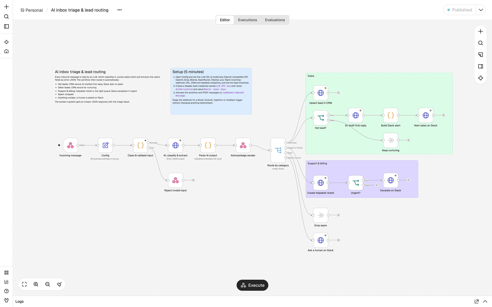
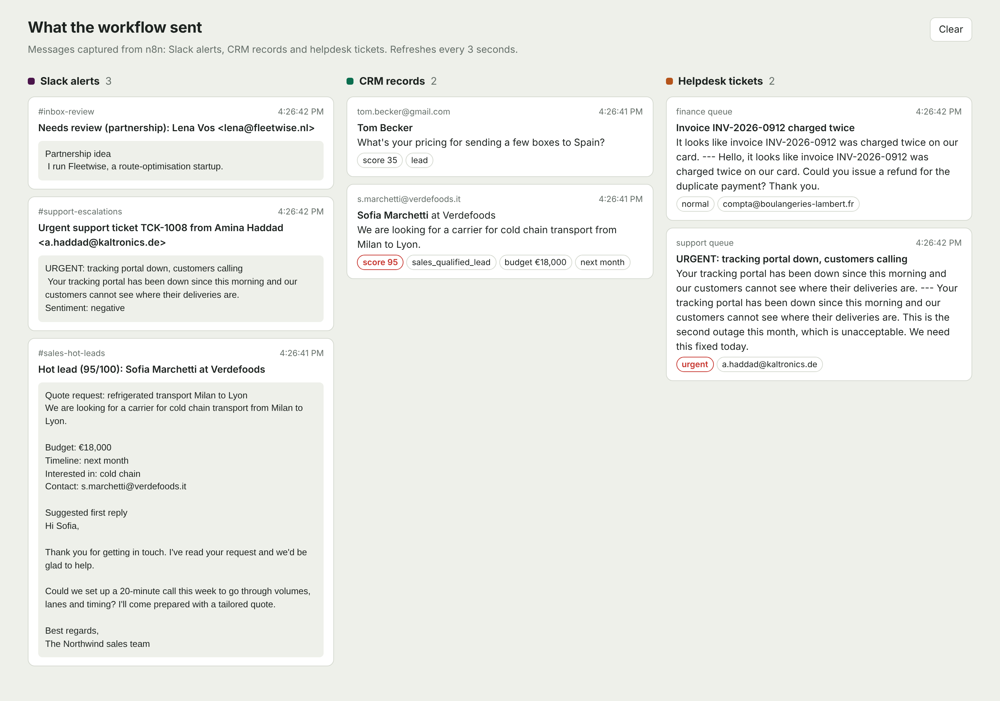

# AI inbox triage & lead routing (n8n + LLM)

[](https://github.com/hamidomail/n8n-ai-lead-triage/actions/workflows/tests.yml)

An **n8n workflow** that reads every inbound message with an LLM, classifies it, scores sales intent, extracts the useful fields as strict JSON, and routes it automatically: hot leads to sales with an AI-drafted reply, support and billing to the helpdesk, spam to the bin, anything unclear to a human.



## The business problem

A shared inbox (or contact form) mixes quote requests, support issues, invoices, partnership pitches and spam. Someone spends hours a day sorting it, and the best leads wait. This workflow does the sorting in under a second per message and only asks a human when the AI is unsure.

## What happens to each message

| Message | Category | What the workflow does |
|---|---|---|
| "40 pallets a week Milan to Lyon, budget €18k/month, start next month" | sales lead, score 95 | CRM record as *sales qualified lead*, AI-drafted first reply, Slack alert to `#sales-hot-leads` with budget, timeline and draft |
| "What's your pricing for a few boxes to Spain? Just curious" | sales lead, score 35 | CRM record as *lead* for nurturing, no alert |
| "Tracking portal down, customers calling, fix it today" | support, high urgency | Helpdesk ticket (priority urgent, support queue) + Slack escalation with ticket number |
| "Invoice charged twice, please refund" | billing | Helpdesk ticket in the finance queue |
| "Guaranteed Google ranking, 500 backlinks" | spam | Dropped |
| "Partnership idea, white-label integration?" | partnership | Posted to `#inbox-review` for a human decision |
| Malformed payload (bad email, empty body) | | Rejected with HTTP 400 and a clear error |

The sender's system receives an immediate `202` JSON response with the triage result:

```json
{
  "status": "accepted",
  "message_id": "msg_mw3pliry_lxw4j",
  "triage": { "category": "sales_lead", "urgency": "medium", "lead_score": 95, "route": "hot_lead",
              "summary": "We are looking for a carrier for cold chain transport from Milan to Lyon.", "needs_human": false }
}
```

## Design choices that make it reliable

- **Strict JSON output** (`response_format: json_object`) with an explicit schema in the prompt.
- **Validation layer** (`Parse AI output`): every field is checked against allowed values and clamped; if the model returns broken JSON, the message is routed to a human instead of failing.
- **Input cleaning** before the LLM: quoted reply threads and signatures are stripped, text is truncated, so tokens (and cost) stay low.
- **Retries** (3 attempts, 3 s apart) on every external call.
- **All business settings in one Config node**: model, endpoints, hot-lead threshold and both prompts. No digging through nodes to change behaviour.
- **Model-agnostic**: any OpenAI-compatible API (OpenAI, Groq, Mistral, OpenRouter, Azure gateways, Ollama for on-premise). The API key lives in an n8n credential, never in the workflow.
- **Swappable trigger**: replace the webhook with Gmail, Outlook, Typeform, HubSpot or a form trigger; nothing downstream changes.

## Run the demo (no API key needed)

The repo includes small **mock services** so the full flow runs offline: an OpenAI-compatible endpoint backed by simple keyword rules (clearly not a real LLM), and fake Slack, CRM and helpdesk endpoints with a page that shows everything the workflow sent.

```bash
docker compose up -d                      # n8n + mock services; the workflow is imported and published
python scripts/send_samples.py            # sends the 6 sample messages
```

- n8n editor: http://localhost:5678 (create the owner account on first visit)
- What the workflow sent: http://localhost:8787

```
from                        category     urgency  score  route          summary
s.marchetti@verdefoods.it   sales_lead   medium      95  hot_lead       We are looking for a carrier for cold chain t
tom.becker@gmail.com        sales_lead   medium      35  nurture        What's your pricing for sending a few boxes t
a.haddad@kaltronics.de      support      high         0  urgent_ticket  Your tracking portal has been down since this
compta@boulangeries-lambert billing      medium       0  ticket         It looks like invoice INV-2026-0912 was charg
deals@rank-boost-pro.biz    spam         low          0  ignored        We offer SEO services with guaranteed ranking
lena@fleetwise.nl           partnership  low          0  human_review   I run Fleetwise, a route-optimisation startup
```



## Switch to a real LLM and real tools

1. In n8n, open **Credentials > LLM API key** and set the value to `Bearer <your key>`.
2. Open the **Config** node:
   - `llm_base_url`: `https://api.openai.com/v1` (or Groq, Mistral, OpenRouter, `http://ollama:11434/v1`...)
   - `llm_model`: e.g. `gpt-4.1-mini`
   - `slack_webhook_url`: a Slack incoming webhook
   - `crm_webhook_url` / `helpdesk_webhook_url`: your endpoints, or replace those two nodes with the native HubSpot, Pipedrive, Zendesk or Freshdesk nodes
3. Adjust `hot_lead_threshold` and the two prompts to the client's business.

Without Docker: import `workflows/ai-lead-triage.json` from the n8n menu (*Import from file*), create the credential, publish.

## Tests

```bash
pip install pytest fastapi httpx
pytest -q     # workflow structure (no dangling links, unreachable nodes, missing retries or secrets) + mock classifier
```

## Files

```
workflows/ai-lead-triage.json      the n8n workflow (n8n 2.x)
workflows/demo-credentials.json    placeholder credential imported by docker compose
mock_services/server.py            offline stand-ins: OpenAI-compatible mock, Slack/CRM/helpdesk capture, results page
samples/messages.json              six realistic test messages
scripts/send_samples.py            sends samples and prints the triage table (standard library only)
```

Tested end to end on n8n 2.46.6: all six samples and the invalid-payload case run green.
